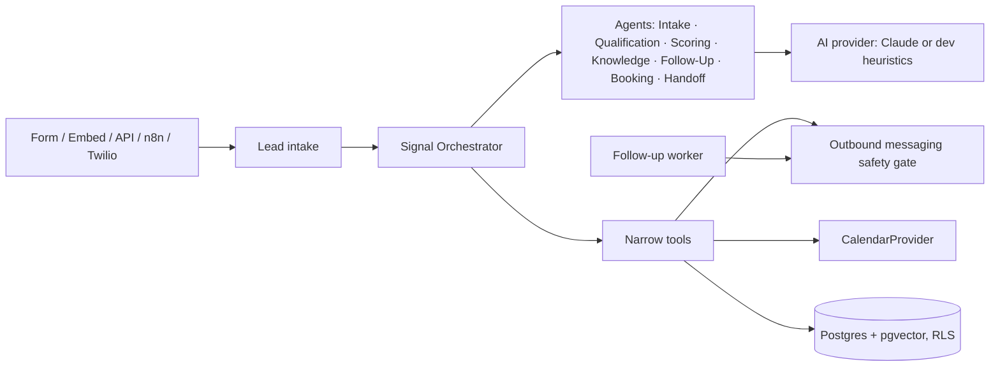

# Signal Leads

**Signal Leads is a product by Kime — AI Agents & Automation.**

Autonomous lead operations for service businesses: Signal receives every lead, extracts what the customer needs, qualifies them one question at a time, scores them, answers from your knowledge base, follows up until they reply, books real appointment times, and hands off to a person when judgement is needed — with every decision logged as a readable receipt on the lead's timeline.

## Quick start

```bash
pnpm install
pnpm dev            # http://localhost:3000 → "Enter demo workspace"
```

No credentials needed: the app runs on an embedded Postgres (PGlite + pgvector) using the same migrations as production, seeds the **Evergreen Roofing** demo (28 leads), uses deterministic dev agents, and simulates email/SMS.

Demo flow: open the lead form (top-right "Lead form") → submit → watch the lead appear → on the lead page use **Simulate customer** to reply (e.g. `42 Maple Ave, it's a detached house`, then `2`) → appointment booked → **Mark won**.

## Architecture



- **Deterministic where possible**: scoring math, qualification gaps, consent/opt-out, stop conditions and next-action policy are code (`src/ai/orchestrator/decide.ts`, `src/features/…`). AI only interprets text, picks questions, and writes messages.
- **Agents never stall**: each agent (`src/ai/agents/*`) has a Zod schema, prompt and heuristic. Claude output is re-validated; on failure it retries once, then falls back deterministically. Runs are logged to `agent_runs` with tokens, cost and latency.
- **Model routing** in one file: `src/ai/providers/models.ts` (Haiku for extraction, Sonnet for writing).
- **Message safety**: every send goes through `src/lib/messaging/outbound.ts` (consent, opt-out, takeover, hours, idempotency, automation enabled).
- **Follow-ups**: persisted, atomically claimed, restart-safe, never double-sent (`src/server/jobs/follow-ups.ts`).
- **Multi-tenant**: every query scoped by an org derived from auth; Supabase RLS in `supabase/migrations`.

## Commands

| Command | |
|---|---|
| `pnpm dev` / `pnpm build` | run / build |
| `pnpm test` | unit + integration tests (in-memory Postgres) |
| `pnpm test:e2e` | Playwright browser tests |
| `pnpm evals` | 10 canonical AI evaluation cases |
| `pnpm db:reset` | rebuild the local demo database |
| `pnpm db:migrate` / `pnpm db:seed` | for `DATABASE_URL` targets |
| `pnpm jobs:follow-ups` | process due follow-ups once |

## Going live

Copy `.env.example` → `.env.local` and fill only what you need: `ANTHROPIC_API_KEY` (Claude), `DATABASE_URL` + Supabase keys (apply `supabase/migrations` with `supabase db push`), `RESEND_*`, `TWILIO_*`, `N8N_WEBHOOK_SECRET`, `CRON_SECRET` (call `POST /api/jobs/follow-ups` every few minutes). Demo orgs always simulate messages.

Endpoints: `POST /api/v1/leads` (API key from Settings), `POST /api/webhooks/n8n` (HMAC-signed), `POST /api/webhooks/twilio`, `GET /api/health`.

## Status / roadmap

MVP complete. Next: Google/Outlook/Calendly calendar adapters, file uploads for knowledge, queue-based workflow execution for multi-instance deploys, per-org AI usage billing.
